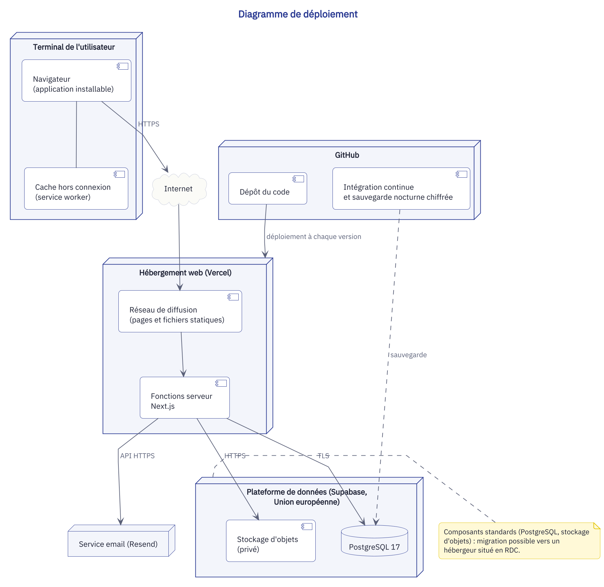
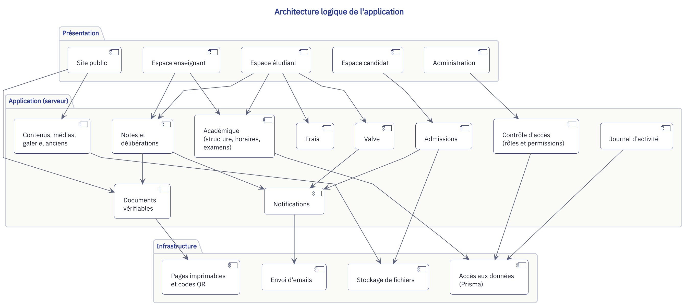

# Architecture

## 1. Vue d'ensemble

La plateforme est une **application web unique** (Next.js, rendu serveur) qui sert à la fois le site public et les espaces connectés. Elle s'appuie sur une base PostgreSQL, un stockage d'objets compatible S3 et un service d'email transactionnel.





## 2. Choix techniques et justification

| Couche | Technologie | Justification |
|---|---|---|
| Framework | Next.js 16 (App Router), React 19 | Rendu serveur et pages statiques pour le référencement et la vitesse en faible connectivité ; un seul projet pour le public et les espaces privés |
| Langage | TypeScript strict | Détection des erreurs à la compilation, code auto-documenté |
| Interface | Tailwind CSS 4, composants maison | Identité visuelle propre à l'institut, CSS minimal envoyé au navigateur |
| Données | PostgreSQL + Prisma | Base relationnelle adaptée aux données académiques ; schéma versionné par migrations |
| Fichiers | Stockage S3 (Supabase Storage) | Standard du marché, portable vers tout autre fournisseur ou un serveur en RDC |
| Authentification | Module maison : sessions en base (cookie httpOnly, jeton stocké sous forme d'empreinte), mots de passe hachés avec Argon2id | Maîtrise complète des règles d'accès et des rôles |
| Validation | Zod | Même schéma de validation côté formulaire et côté serveur |
| Emails | Resend | Délivrabilité ; sans clé, les emails sont seulement journalisés |
| Documents | Pages imprimables A4 + codes QR (`qrcode`) | Relevés, reçus, bulletins et attestations vérifiables |
| Tests | Vitest (règles métier), Playwright (parcours), axe (accessibilité) | Preuves de qualité mesurables |
| Hébergement | Vercel (Francfort) | Déploiement continu à chaque push, préproduction par branche |

## 3. Organisation du code

```
web/
  src/
    app/
      (public)/          site institutionnel
      (auth)/            connexion, inscription candidat, mot de passe
      candidat/          espace candidat
      etudiant/          espace étudiant
      enseignant/        espace enseignant
      admin/             administration
      verifier/[code]/   vérification publique des documents
      api/               routes techniques (fichiers, PDF, webhooks)
    components/          composants d'interface réutilisables
    features/            logique par domaine (admissions, valve, notes, frais…)
      <domaine>/
        actions.ts       mutations serveur (contrôle d'accès + validation)
        queries.ts       lectures serveur
        schema.ts        schémas de validation
        rules.ts         règles métier pures, testées
    lib/                 accès base, stockage, email, PDF, sécurité
  prisma/
    schema.prisma        modèle de données
    migrations/          historique des évolutions du schéma
    seed.ts              données de référence (filières, rôles, réglages)
  tests/
    unit/                règles métier
    e2e/                 parcours et contrôle d'accès
```

## 4. Sécurité

| Risque (OWASP Top 10) | Mesure |
|---|---|
| Contrôle d'accès défaillant | Chaque action serveur vérifie la permission requise et le périmètre (ses cours, sa promotion, ses données) ; tests automatisés d'intrusion par rôle |
| Défaillances cryptographiques | HTTPS partout, mots de passe hachés (Argon2id), jetons de réinitialisation hachés et à usage unique |
| Injection | Requêtes paramétrées via l'ORM, validation systématique des entrées |
| Conception non sécurisée | Règles métier isolées et testées, principe du moindre privilège |
| Mauvaise configuration | En-têtes de sécurité (CSP, HSTS, X-Frame-Options), secrets uniquement en variables d'environnement |
| Composants vulnérables | Dépendances à jour, audit automatisé |
| Authentification | Limitation des tentatives, verrouillage temporaire, sessions expirantes |
| Intégrité | Journal d'activité des actions sensibles, documents officiels vérifiables |
| Journalisation et surveillance | Journal d'activité consultable, suivi des erreurs, surveillance de disponibilité |
| Falsification de requêtes côté serveur | Aucune requête sortante construite à partir d'une adresse fournie par l'utilisateur |

Les fichiers téléversés sont contrôlés (type réel, taille), stockés hors de la racine publique et servis par une route qui vérifie les droits.

## 5. Performance en faible connectivité

- Pages publiques pré-rendues et mises en cache sur le réseau de diffusion.
- Images converties automatiquement en formats modernes (AVIF, WebP) et dimensionnées selon l'écran.
- Polices auto-hébergées, sous-ensemble latin, une seule famille variable.
- JavaScript chargé uniquement pour les composants interactifs.
- Service worker : page hors-ligne, mise en cache de l'horaire, de la valve et des notes déjà consultées.

## 6. Données personnelles

- Collecte minimale ; notice d'information sur chaque formulaire ; consentement explicite à la candidature.
- Accès aux données sensibles (notes, frais) limité au titulaire et aux rôles habilités, et journalisé.
- Sauvegardes : quotidiennes par le fournisseur, plus un export hebdomadaire conservé séparément (exigence de l'institut : hebdomadaire au minimum).
- Conservation des dossiers des anciens étudiants sur la longue durée (exigence de l'institut).
- Architecture portable pour un hébergement en RDC (article 201 du Code du numérique).

## 7. Environnements

| Environnement | Rôle | Données |
|---|---|---|
| Local | Développement | Jeu de données de démonstration |
| Préproduction | Une version par branche, pour validation | Données de démonstration |
| Production | Branche `main` | Données réelles |
